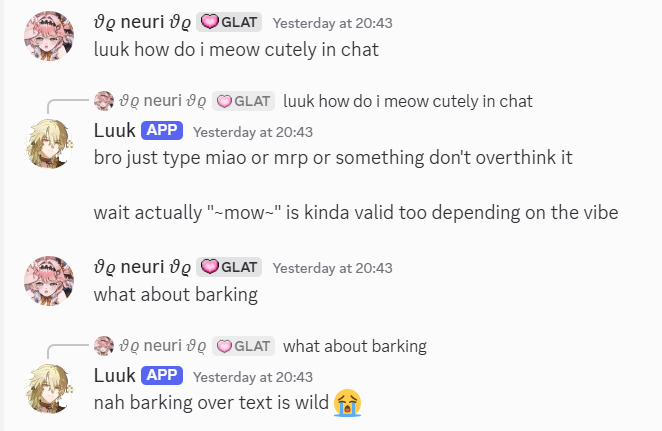

StaySafeBot is your super cozy, friendly Discord companion powered by Google Gemini and `discord.py`! It’s designed for gentle chats, listening-first venting, practical brainstorming, and safe identity exploration, all wrapped up with cute privacy features and an easy setup guide below! :3 <3

---

# ✨ StaySafeBot >< ✨

Welcome to **StaySafeBot**, your little digital sanctuary in Discord! Whether you need a warm space to vent, a gentle buddy to brainstorm with, or a safe corner for identity exploration, this bot is here to listen and chat with you! ⸜(｡˃ ᵕ ˂ )⸝♡

> **Important Note!** 🌸
> This is a friendly AI sounding board, *not* a licensed mental health professional or therapist. Its responses can sometimes make mistakes, and it's definitely not a crisis service. If someone is ever in immediate danger, please reach out to local emergency services or a trusted person right away! <3


---

## 🌟 Magical Features

* **Natural chat**: Mention the bot, reply to one of its messages, or message it in a DM/private thread.
* **Image and video understanding**: Attach images or videos to a message or include them in a reply to a bot message. Media uploads are limited to 15 MB total per message.
* **`/mode`**: Choose casual, vent, advice, or identity mode for yourself in the current channel.
* **`/rant`**: Need to let it all out? This gives you a listening-first, completely nonjudgmental response. :3
* **`/private`**: Creates a cozy, invite-only private thread just for you and the bot!
* **Automatic Replies**: Responds to mentions, replies to its messages, DMs, and private-thread messages.
* **`/reset`**: Clears *only* your personal conversation history in the current channel/thread so you can start fresh. ><
* **Memory & Privacy**: Conversation history lives safely in process memory only (restarting clears it!), keeping everyone's chats completely isolated.
* **Lightning Fast**: Powered by low-effort thinking for super quick, snappy replies!

*Note:* Discord private threads aren't truly end-to-end encrypted, and server staff with permissions might see them, so treat it like a friendly chat rather than a clinical vault! 🐾

---

## 🛠️ What You Need to Get Started

* **Python 3.10** or later
* A **Discord Application & Bot Token**
* A **Google Gemini API key** with access to `gemini-3.5-flash-lite`

---

## 🪄 Step-by-Step Setup Guide

1. **Create the Bot:** Head over to the Discord Developer Portal, spin up a new application, add a bot, and copy its secret token!
2. **Enable Intents:** Turn on the **Message Content Intent** in the Developer Portal so the bot can respond to mentions and private thread messages. (Slash commands work without it!) ✨
3. **Invite It Over:** Invite the bot to your server using `bot` and `applications.commands` OAuth scopes, and give it these handy permissions:
* View Channels and Send Messages
* Send Messages in Threads
* Create Private Threads
* Manage Threads (so it can invite you to your private thread!)


4. **Set Up Your Python Environment:** Open your folder and run these commands:
```powershell
py -3.10 -m venv .venv
.\.venv\Scripts\Activate.ps1

```


*(If you're on macOS or Linux, use `python3 -m venv .venv` and `source .venv/bin/activate` instead!)*
5. **Install Dependencies:**
```shell
python -m pip install -r requirements.txt

```


6. **Configure Your Credentials:** Copy the example file and fill in your keys:
```powershell
Copy-Item .env.example .env

```


*(Keep your `.env` super secret—it stays safe out of Git!)* :3
7. **Launch the Bot!**
```shell
python main.py

```


*(Global slash commands can sometimes take a little moment to show up in Discord after your very first launch—don't panic!)* ><

---

## 💬 Commands & How to Play

* Mention the bot, reply to one of its messages, or message it in a DM/private thread to chat.
* Attach an image or video to a message to ask the bot about it; clips without a caption get a casual prompt automatically. The combined media size limit is 15 MB.
* `/mode mode:<mode>` — Set your mode for the current channel; the choice is per user.
* `/rant message:<text>` — Jump right into the cozy vent/listening mode!
* `/private` — Spin up a secret little invite-only thread.
* `/reset` — Wipe your personal history slate clean.
* `/help` — Peek at the commands and safety disclaimer anytime.

The bot won't respond to every ordinary message in public channels; mention it or reply to one of its messages there.

---

## 📦 Project Layout

```text
StaySafeBot/
├── cogs/
│   └── chat.py
├── services/
│   └── gemini_service.py
├── .env.example
├── main.py
└── requirements.txt

```

---

## 🔍 Troubleshooting (If Things Get Wonky ><)

* **Missing environment variable:** Double-check that your `.env` file is sitting in the right folder and that your variable names match `.env.example` perfectly!
* **No replies to mentions or private threads:** Make sure **Message Content Intent** is toggled *ON* in the Developer Portal and that the bot has its required channel permissions.
* **`/private` fails:** Ensure the bot has permission to *Create Private Threads*, *Send Messages in Threads*, and *Manage Threads* in that specific channel.
* **Gemini quota/rate limit:** Give it a little breather and try again! Rate limits are managed by your Google project. <3
